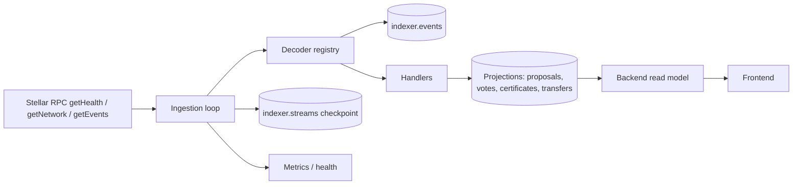

# Design: Soroban event ingestion via RPC `getEvents` and the DB write model

| | |
|---|---|
| **Status** | Draft for review |
| **Author** | projectsfame |
| **Issue** | [#1](https://github.com/WeAcademy/bytechain-indexer/issues/1) |
| **Service** | `bytechain-indexer` |
| **Chain path** | Stellar Soroban (not EVM, not Horizon SSE) |
| **Contracts** | ByteChainDAO, ByteChainCertificate, ByteChainToken |
| **Related** | `bytechain-contracts` design docs, backend read model, frontend DAO/certificate pages |

---

## 1. Summary

The indexer is a Node.js/TypeScript worker that polls Stellar RPC
`getEvents`, decodes Soroban contract events and writes an idempotent
projection into PostgreSQL. The backend reads that projection instead of
querying the chain on every request.

This document replaces the EVM/Horizon assumptions in the current README with
the actual ingestion path: **Stellar RPC `getEvents` over JSON-RPC**, with
durable ledger checkpoints, per-page cursors and contract-specific decoders.

### Goals

- Ingest DAO proposals/votes, certificate mints/revocations and token transfers
  in near real time.
- Resume safely after restarts without missing or double-applying events.
- Detect and report retention gaps instead of silently skipping history.
- Keep large integers (`i128`) exact.
- Expose lag/health metrics and a runbook for operators.

### Non-goals

- Running a Stellar validator or a full history archive.
- Replacing the backend REST API.
- Indexing every contract on the network (only configured contracts).
- EVM support or Horizon server-sent events.
- Writing personally identifiable information (PII) on-chain or into the
  indexer schema.
- Becoming the source of truth for balances; the chain remains authoritative.

---

## 2. Background and constraints

Soroban contracts emit events that Stellar RPC retains for a bounded ledger
window. The stock retention default is **120,960 ledgers (about 7 days)**,
configurable by the RPC operator. `getHealth` reports the effective window and
the currently available range (`oldestLedger`, `latestLedger`,
`ledgerRetentionWindow`).

The indexer therefore cannot assume it can always replay from genesis. It must:

1. Persist a durable checkpoint.
2. Catch up while the checkpoint is inside the retention window.
3. Detect a gap early and use a backfill source if possible.

Stellar consensus is final: once a ledger closes it is not reorganised the way
EVM blocks are. The risks are duplicate delivery, RPC lag, provider inconsistency
and testnet resets, not chain reorgs (see §7).

Useful RPC facts:

| Constraint | Value |
|---|---|
| Event type filter | `contract` or `system`; use `contract` |
| Max filters per request | 5 |
| Max contract ids per filter | 5 |
| Topic segments per filter | 1–4 (`*` / `**` matchers allowed) |
| Page size | 1–10,000, default 100 |
| Event order | ascending `id` (ledger, tx, operation, event index) |
| `startLedger` / `endLedger` | `endLedger` exclusive; cannot be combined with a cursor |
| Retention | operator-defined; default ~7 days |
| Event payload | base64 XDR by default; JSON format is explicitly unstable |
| Unique event id | TOID + event index, e.g. `0016010972359577600-0000000001` |

The service must decode XDR with a pinned `@stellar/stellar-sdk` version rather
than relying on RPC's JSON schema.

---

## 3. Architecture



**Components**

| Component | Responsibility |
|---|---|
| RPC client | JSON-RPC calls, retries, timeouts, rate-limit handling |
| Stream manager | One stream per contract, checkpoint and lease |
| Decoder registry | XDR → typed event keyed by contract + event symbol |
| Handlers | Idempotent projection writes (proposal, vote, certificate, transfer) |
| Store | `events`, projections, checkpoints, dead letters, gaps |
| Health server | Liveness, readiness, lag and retention headroom |

One stream per contract is recommended: the three contracts have different
event schemas and failure domains, and a malformed certificate event should not
block DAO ingestion. Each stream has its own checkpoint. The single-writer lease
(§12) ensures two workers never advance the same stream concurrently.

---

## 4. Ingestion algorithm

### 4.1 Startup

1. Load and validate configuration (RPC URL, network passphrase, contract ids,
   start ledger, page size, finality lag, DB URL).
2. Connect to PostgreSQL, run migrations, acquire the stream lease.
3. Call `getNetwork` and compare the passphrase with the configured network;
   refuse to start on a mismatch.
4. Call `getHealth`; record `oldestLedger`, `latestLedger` and
   `ledgerRetentionWindow`.
5. Load the checkpoint. Choose the first ledger:
   - fresh database: `max(START_LEDGER, oldestLedger)`; if `START_LEDGER` is
     older than `oldestLedger`, record a pre-window gap and require backfill;
   - existing checkpoint: `last_scanned_ledger + 1`; if that is below
     `oldestLedger`, stop and alert (§8).
6. Start the poll loop.

### 4.2 Poll loop

```text
loop every POLL_INTERVAL_MS (default 2s, with jitter):
  health = getHealth()
  end = min(health.latestLedger - FINALITY_LAG_LEDGERS, ...)
  if end <= checkpoint.last_scanned_ledger: sleep; continue

  start = checkpoint.last_scanned_ledger + 1
  if start < health.oldestLedger: raise GAP alert; stop this stream

  cursor = null
  do:
    params = cursor
      ? { filters, pagination: { cursor, limit: PAGE_LIMIT } }
      : { startLedger: start, endLedger: end, filters, pagination: { limit: PAGE_LIMIT } }
    page = getEvents(params)

    process page in one DB transaction:
      for each event (ascending id):
        insert into indexer.events ... on conflict (id) do nothing
        if inserted and inSuccessfulContractCall:
          decoded = decode(event)
          apply handler(decoded)   -- upsert, idempotent
      update checkpoint.last_scanned_ledger = end - 1
      update checkpoint.last_event_ledger = max(...)

    cursor = page.cursor
  while page.events.length == PAGE_LIMIT and cursor

  sleep until next ledger
```

Notes:

- **Durable checkpoint is `last_scanned_ledger`, not the cursor.** The cursor is
  only used to page through one scan window. Restarting from
  `last_scanned_ledger + 1` keeps gap detection explicit and avoids relying on
  an opaque cursor surviving the retention window.
- `endLedger` is exclusive. With `latestLedger = 1000` and
  `FINALITY_LAG_LEDGERS = 2`, scan through ledger 997 and store 997.
- Process a page in one transaction: event rows, projections and the checkpoint
  update commit together. A crash replays the page; the unique event id and
  idempotent handlers make replay harmless.
- Cap `PAGE_LIMIT` at 500 in the service even though RPC allows 10,000; smaller
  pages bound transaction size and memory.
- The loop should use `getHealth` rather than `getLatestLedger` so retention and
  lag are checked in the same call.

### 4.3 Filters

For each stream, start with one filter restricted to that contract:

```json
{
  "type": "contract",
  "contractIds": ["CDAO..."],
  "topics": [["AAAADwAAAAdWb3RlQ2FzdA==", "*"]]
}
```

The topic value is the base64 XDR `Symbol` (`VoteCast` in the example), not the
plain string. Topic filters are an optimisation, not a correctness requirement:
decode every event and ignore unknown symbols. If the contract emits several
event types, one unfiltered contract filter is simpler and avoids the
5-filter/5-contract limits. Filtering by event type is recommended only after
the event schema is stable and the RPC budget requires it.

Do not index `system` events or the native-asset fee events. Contract filters
already exclude most of them, but the decoder must still reject unexpected
contract ids and unknown topics.

### 4.4 Failure behaviour

| Failure | Behaviour |
|---|---|
| RPC timeout / 5xx / 429 | Exponential backoff with jitter; do not advance checkpoint |
| Malformed XDR for one event | Record in `dead_letters`, increment metric, advance (do not wedge the stream); alert |
| DB unavailable | Retry current page; do not advance checkpoint |
| Unknown contract event | Store raw row, mark `decoded_type = null`; no projection; advance |
| `inSuccessfulContractCall = false` | Store raw row for audit, do not project; advance |
| Gap below `oldestLedger` | Stop stream, record gap, page operator (§8) |
| Network reset detected | Stop all streams; do not auto-truncate (§7) |

A poison event should not block forever. A DB or RPC outage should not lose
position. Distinguish the two: **decode errors are skippable with a dead letter;
infrastructure errors are retryable without advancing.**

---

## 5. Decoding Soroban events

RPC returns `topic` as an array of base64 ScVals and `value` as one base64
ScVal. Decode with the pinned SDK:

```ts
import { scValToNative, xdr } from "@stellar/stellar-sdk";

const topics = event.topic.map((segment) =>
  scValToNative(xdr.ScVal.fromXDR(segment, "base64")),
);
const value = scValToNative(xdr.ScVal.fromXDR(event.value, "base64"));

// Example: [Symbol("vote_cast"), voterAddress] -> { proposal_id, support, weight }
```

Rules:

- The first topic is normally the event symbol; the remaining topics are
  indexed fields chosen by the contract.
- `Address` decodes to a StrKey string; `i128`/`u128` decode to `BigInt` (never
  coerce to `number`); structs/maps decode to objects; vectors to arrays.
- Treat the payload as untrusted. Validate required fields, types, ranges and
  string lengths before writing a projection.
- Keep a **versioned decoder registry**:
  `contractId -> eventSymbol -> { schemaVersion, decode, handle }`. A contract
  upgrade that changes an event shape needs a new decoder version and a replay
  plan; do not silently mutate the old decoder.
- Unknown events are still stored in `indexer.events` so a later decoder can
  replay them without re-fetching from RPC (subject to retention).

Event schemas are defined by the contract design docs for
`ByteChainDAO` and `ByteChainCertificate`. The indexer must not guess field
names; coordinate the registry with the contract release.

---

## 6. Database write model

Use a dedicated `indexer` schema in the backend PostgreSQL database (or a
separate database with the same tables). Keeping indexer tables separate from
the backend's domain tables avoids migration collisions and makes it clear which
rows are chain-derived.

### 6.1 Checkpoints and raw events

```sql
create schema if not exists indexer;

create table indexer.streams (
  id                    text primary key,          -- dao | certificate | token
  contract_id           text not null,
  network               text not null,             -- testnet | mainnet
  last_scanned_ledger   bigint not null default 0,
  last_event_ledger     bigint,
  last_ledger_hash      text,
  updated_at            timestamptz not null default now()
);

create table indexer.events (
  id                          text primary key,     -- RPC event id (TOID-index)
  stream_id                   text not null references indexer.streams(id),
  contract_id                 text not null,
  ledger                      bigint not null,
  ledger_closed_at            timestamptz,
  tx_hash                     text not null,
  transaction_index           integer,
  operation_index             integer,
  topics                      jsonb not null,       -- base64 ScVal array
  value                       text not null,        -- base64 ScVal
  event_type                  text not null,        -- contract | system
  in_successful_contract_call boolean not null,
  decoded_type                text,
  decoded                     jsonb,
  ingested_at                 timestamptz not null default now()
);

create index events_contract_ledger_idx
  on indexer.events (contract_id, ledger);
create index events_decoded_type_idx
  on indexer.events (decoded_type, ledger);
```

The event `id` is globally unique for a network and is the deduplication key
recommended by Stellar RPC. Do not use `(tx_hash, topic)` as the primary key;
transactions can emit multiple events, and topic shapes can repeat.

### 6.2 DAO projections

```sql
create table indexer.dao_proposals (
  onchain_id           bigint primary key,
  legacy_id            uuid unique,                -- mapping to backend rows
  proposer             text not null,
  title                text not null,
  description_uri      text,
  description_hash     text,
  category             text,
  status               text not null,              -- ACTIVE | SUCCEEDED | ...
  start_ledger         bigint not null,
  end_ledger           bigint not null,
  snapshot_ledger      bigint not null,
  yes_weight           numeric(38,0) not null default 0,
  no_weight            numeric(38,0) not null default 0,
  abstain_weight       numeric(38,0) not null default 0,
  total_voting_power   numeric(38,0),
  action_type          text,
  action               jsonb,
  created_at           timestamptz,
  executed_at          timestamptz,
  cancelled_at         timestamptz,
  cancel_reason        text,
  last_event_id        text references indexer.events(id),
  updated_at           timestamptz not null default now()
);

create table indexer.dao_votes (
  proposal_id   bigint not null references indexer.dao_proposals(onchain_id),
  voter         text not null,
  support       text not null,                     -- YES | NO | ABSTAIN
  weight        numeric(38,0) not null,
  cast_at       timestamptz,
  tx_hash       text,
  event_id      text unique references indexer.events(id),
  primary key (proposal_id, voter)
);
```

- `numeric(38,0)` stores `i128` exactly. In TypeScript, use `BigInt` or a
  big-decimal library; never `Number`.
- Tallies are derived state. Recompute them from `dao_votes` inside the
  event transaction (or apply a guarded delta only when the event insert
  returned a row). A replay must not double-count.
- A `VoteCast` for an unknown proposal is a data error (events from one contract
  are ordered by id): dead-letter it and alert rather than inventing a proposal.
- Keep `legacy_id` for links to pre-cutover backend proposals; do not fabricate
  on-chain votes for legacy rows.

### 6.3 Certificate projections

```sql
create table indexer.chain_certificates (
  onchain_id        bigint primary key,
  contract_id       text not null,
  recipient         text not null,
  issuer            text not null,
  course_id         text not null,
  course_title      text,
  metadata_uri      text,
  metadata_hash     text,
  issued_at         timestamptz,
  revoked           boolean not null default false,
  revoked_at        timestamptz,
  revocation_reason text,
  mint_tx_hash      text,
  last_event_id     text references indexer.events(id),
  updated_at        timestamptz not null default now(),
  unique (recipient, course_id)
);
```

- `CertificateMinted` upserts by `onchain_id`; the uniqueness constraint protects
  against a duplicate mint event.
- `CertificateRevoked` updates status; it never deletes the row. History remains
  queryable.
- The table contains no email/name. The backend joins to `users` via
  `users.walletAddress` for display. If the certificate design adds
  `MetadataUpdated`, add a version/history table rather than overwriting the
  original silently.

### 6.4 Token projections

```sql
create table indexer.token_transfers (
  event_id      text primary key references indexer.events(id),
  contract_id   text not null,
  ledger        bigint not null,
  tx_hash       text not null,
  from_address  text not null,
  to_address    text not null,
  amount        numeric(38,0) not null,
  asset         text,
  occurred_at   timestamptz,
  ingested_at   timestamptz not null default now()
);

create index token_transfers_from_idx on indexer.token_transfers (from_address, ledger);
create index token_transfers_to_idx on indexer.token_transfers (to_address, ledger);

create table indexer.reward_events (
  event_id      text primary key references indexer.events(id),
  recipient     text not null,
  amount        numeric(38,0) not null,
  reason        text,
  ledger        bigint not null,
  tx_hash       text not null,
  occurred_at   timestamptz
);
```

Transfers are append-only. Do not maintain a mutable balance from events unless
the handler also reconciles against `balance_of`; the token contract remains the
source of truth. Reward events are separate from transfers so XP history is not
confused with wallet movements.

### 6.5 Operations tables

```sql
create table indexer.dead_letters (
  event_id    text primary key,
  stream_id   text not null,
  payload     jsonb not null,
  error       text not null,
  attempts    integer not null default 1,
  first_seen  timestamptz not null default now(),
  last_seen   timestamptz not null default now(),
  resolved_at timestamptz
);

create table indexer.gaps (
  id          bigserial primary key,
  stream_id   text not null,
  from_ledger bigint not null,
  to_ledger   bigint not null,
  reason      text not null,
  detected_at timestamptz not null default now(),
  resolved_at timestamptz
);
```

`events` is the raw audit log; projections can always be rebuilt from it while
the rows remain (and from the chain/archive if they do not). Raw rows are large;
set a retention policy (for example 90 days) only after projections and backfill
are proven, or archive to object storage.

---

## 7. Finality, duplicates and resets

### Finality

Stellar's SCP closes ledgers deterministically. There is no EVM-style
probabilistic reorg and no confirmation-depth requirement. The indexer still
processes a small **finality lag** (default 2 ledgers) behind `latestLedger` to
avoid racing RPC ingestion and to make `endLedger` handling predictable. The lag
is an operational buffer, not a reorg defence.

### Duplicates

RPC explicitly recommends deduplicating by event `id`. Duplicates can occur
because of retries, overlapping scan ranges or a crash after writing projections
but before the checkpoint. `indexer.events.id` plus idempotent handlers make this
safe. Log and count duplicates; a sudden spike usually indicates a checkpoint or
lease bug.

### No reorg rollback path

There is intentionally no `onReorg`/rollback job. If a provider claims a
different ledger at the same height on the same network, treat it as corruption:
stop, compare `last_ledger_hash` (via `getLedgers`/`getLedger`), and investigate.

### Network resets

Testnet (and a catastrophic mainnet reset) can restart ledger numbering. Detect:

- `latestLedger` moves backwards across polls;
- the hash for `last_scanned_ledger` changes;
- `getNetwork` passphrase or protocol version differs from the stored value;
- contract ids no longer exist.

On detection, halt all streams and require an operator to choose
`RESET_INDEXER=true`, which clears checkpoints/projections for that network after
a backup. Never auto-truncate in production.

---

## 8. Retention gaps and backfill

`getHealth` is checked every poll. Define:

```text
headroom = last_scanned_ledger - oldestLedger
window   = latestLedger - oldestLedger
```

Alert when `headroom > 0.8 * window` and page at `headroom > 0.95 * window`.

If the checkpoint is already below `oldestLedger`:

1. Record an `indexer.gaps` row and stop the affected stream (do not skip).
2. Try a backfill source:
   - a self-hosted Stellar RPC with a larger retention window;
   - a Stellar Data Lake / Galexie archive containing the missing ledgers;
   - a replay from the contract deployment ledger, if it is still retained.
3. Run `npm run backfill -- --from <ledger> --to <ledger>` against the archive
   source. Backfill uses the same decoder/handlers and dedupes by event id.
4. Mark the gap resolved only after the range is fully ingested and projections
   reconcile.

If no source exists, leave the gap open, surface "history incomplete from
ledger X" in the API, and document it. Silent gaps are worse than a visible
limitation.

Backfill writes raw events and projections but **does not move the live
checkpoint backwards**. It is a separate, leased job; overlap with live
ingestion is safe because of the unique event id.

---

## 9. Event handlers

| Event | Projection action | Idempotency |
|---|---|---|
| `ProposalCreated` | Insert/upsert `dao_proposals` with zero tallies | PK `onchain_id`; `last_event_id` guard |
| `VoteCast` | Insert `dao_votes`; recompute tallies | PK `(proposal_id, voter)`; unique `event_id` |
| `ProposalFinalized` | Set status and final tallies | Status transition guard |
| `ProposalExecuted` | Set `EXECUTED`, `executed_at` | Terminal status guard |
| `ProposalCancelled` | Set `CANCELLED`, reason/time | Terminal status guard |
| `ConfigUpdated` | Append config history; update current | Event id unique |
| `CertificateMinted` | Upsert `chain_certificates` | PK `onchain_id`; unique `(recipient, course_id)` |
| `CertificateRevoked` | Set revoked fields | Event id unique; terminal guard |
| `Transfer` | Append `token_transfers` | PK `event_id` |
| `RewardIssued` | Append `reward_events` | PK `event_id` |
| Unknown | Store raw only | `decoded_type = null` |

Handlers must be **pure functions of the decoded event plus current DB state**
and must not call the RPC. They run inside the page transaction. Any handler
that needs an external lookup (for example wallet → user) should be a backend
join, not an indexer RPC call.

Status transitions should reject impossible regressions (for example
`EXECUTED -> ACTIVE`) and log them as data errors instead of overwriting.

---

## 10. Health, metrics and alerting

Expose:

```text
GET /health   -> liveness + per-stream status
GET /ready    -> DB reachable, lease held, all streams within retention
GET /metrics  -> Prometheus text format
```

Metrics:

| Metric | Meaning |
|---|---|
| `indexer_events_ingested_total{stream,type}` | Applied events |
| `indexer_events_duplicate_total{stream}` | Duplicate ids seen |
| `indexer_events_failed_total{stream,reason}` | Decode/handler failures |
| `indexer_stream_lag_ledgers{stream}` | `latestLedger - last_scanned_ledger` |
| `indexer_retention_headroom_ledgers{stream}` | Distance from `oldestLedger` |
| `indexer_rpc_errors_total{method,code}` | RPC failures |
| `indexer_db_errors_total` | DB failures |
| `indexer_checkpoint_age_seconds{stream}` | Time since last advance |
| `indexer_dead_letters_total{stream}` | Unresolved dead letters |
| `indexer_gap_ledgers{stream}` | Open gap size |

Alerts:

- lag > 1,000 ledgers for 10 minutes;
- retention headroom > 80% of the window;
- any open gap or dead letter;
- checkpoint age > 2 minutes while `latestLedger` advances;
- RPC error rate > 5% over 5 minutes;
- network reset detected.

Logs are structured JSON with `stream`, `ledger`, `event_id`, `tx_hash`,
`handler`, `duration_ms` and `error`. Never log full secrets or PII.

---

## 11. Configuration

| Variable | Default | Purpose |
|---|---|---|
| `STELLAR_RPC_URL` | testnet RPC | JSON-RPC endpoint |
| `NETWORK_PASSPHRASE` | required | Reject wrong network |
| `DAO_CONTRACT_ID` | required | StrKey `C...` contract |
| `CERTIFICATE_CONTRACT_ID` | required | StrKey `C...` contract |
| `TOKEN_CONTRACT_ID` | required | StrKey `C...` contract |
| `START_LEDGER` | deployment ledger | Cold-start ledger |
| `DATABASE_URL` | required | PostgreSQL connection |
| `INDEXER_SCHEMA` | `indexer` | Schema name |
| `POLL_INTERVAL_MS` | `2000` | Poll cadence |
| `PAGE_LIMIT` | `200` | Events per RPC page (≤500 enforced) |
| `FINALITY_LAG_LEDGERS` | `2` | Process behind `latestLedger` |
| `RETENTION_WARN_RATIO` | `0.8` | Headroom alert threshold |
| `DB_POOL_SIZE` | `10` | Connection pool |
| `LOG_LEVEL` | `info` | Structured logging |
| `METRICS_PORT` | `9464` | Prometheus endpoint |
| `RESET_INDEXER` | `false` | Guarded operator reset |

Validate contract ids with `StrKey.isValidContract`, reject non-HTTPS RPC URLs
outside localhost, and fail fast on a missing passphrase.

---

## 12. Deployment and operations

- **Single writer per stream.** Acquire a PostgreSQL advisory lock on
  `hash(stream_id)` (or use a `streams.lease_owner`/`lease_expires_at` row with
  `SELECT ... FOR UPDATE SKIP LOCKED`). Standbys stay idle; they take over when
  the lease expires. This prevents two workers from advancing the same
  checkpoint.
- **Migrations.** Use a migration tool (TypeORM migrations, node-pg-migrate or
  Prisma) and run them before the worker starts. Never rely on
  `synchronize: true` in production.
- **Graceful shutdown.** Stop polling, finish the current page transaction,
  release the lease and close the pool. Do not exit mid-transaction.
- **Docker/Kubernetes.** Non-root image, read-only filesystem, liveness/readiness
  probes, resource limits, one replica per stream (or lease-based leader
  election).
- **Runbook.**
  - cold start and catch-up;
  - gap detected / backfill;
  - network reset / `RESET_INDEXER`;
  - decoder upgrade and replay from `indexer.events`;
  - dead-letter inspection and resolve;
  - RPC provider failover;
  - retention emergency (start backfill before the window closes).
- **Provider strategy.** Use one trusted RPC for ingestion, optionally a second
  for cross-checking ledger hashes. Do not load-balance `getEvents` across
  providers with different retention or indexing lag.

---

## 13. Security considerations

- **Read-only keys.** The indexer needs no Stellar secret key; it never signs.
  Use a dedicated RPC key if the provider requires one, stored in a secret
  manager.
- **Untrusted payloads.** Decode defensively, cap lengths, validate addresses and
  integers, and never execute or fetch URLs from event data. Metadata URIs are
  strings to store, not to dereference.
- **Contract allowlist.** Reject events whose `contractId` is not in the configured
  set, even if the RPC returns them. Do not let a typo index an attacker
  contract.
- **Network confusion.** Compare the passphrase and contract ids on startup and
  periodically. Testnet and mainnet events must never share a database.
- **DB least privilege.** The worker writes only the `indexer` schema; the
  backend reads projections. Use separate roles and credentials.
- **SQL injection.** Use parameterised queries; event payloads are data, not SQL.
- **Denial of service.** Bound page size, payload size, decoding time and DB
  transaction time. A malformed event goes to dead letters, not an infinite
  retry loop.
- **Privacy.** Wallet addresses are public; do not add emails/names to the
  indexer schema. Backend joins can expose only what the user is allowed to see.
- **Upgrade integrity.** Pin the contract WASM hashes and decoder versions; log
  the decoder version with every event.

---

## 14. Testing strategy

### Unit tests

- XDR decoding for each event type with real base64 fixtures, including
  `Address`, `Symbol`, `i128`, structs and unexpected fields.
- Decoder rejects unknown symbols, wrong contract ids and malformed payloads.
- Handler idempotency: applying the same event twice leaves projections and
  tallies unchanged.
- Vote tally recomputation matches independent sums, including duplicate
  `VoteCast` and out-of-order replays.
- Status transition guards reject regressions.
- Checkpoint math: empty ranges, page exactly `PAGE_LIMIT`, final partial page,
  `endLedger` exclusive, finality lag.
- Retention gap detection and reset detection.

### Integration tests

1. Start a local Stellar quickstart/testnet RPC and a PostgreSQL container.
2. Deploy the DAO, certificate and token contracts.
3. Emit events (create proposal, vote, mint, revoke, transfer).
4. Assert projections and checkpoints after each batch.
5. Kill the worker mid-page and restart; assert no loss and no double-count.
6. Simulate RPC 429/500/timeout and DB restart; assert retries and recovery.
7. Replay an overlapping range; assert duplicates are ignored.
8. Simulate a checkpoint below `oldestLedger`; assert the stream stops and a gap
   row is written.
9. Run a backfill over an overlapping range and assert projections reconcile.

### Load and chaos

- 10,000-event pages, large topic payloads, high ledger throughput.
- BigInt values above 2^53 round-trip exactly.
- Network reset simulation and guarded reset flow.
- Long-running soak with checkpoint/retention dashboards.

---

## 15. Alternatives considered

| Alternative | Why not |
|---|---|
| Horizon server-sent events | Horizon does not stream Soroban contract events; current README is outdated |
| Poll the backend / chain per API request | Slow, rate-limited, couples API latency to RPC |
| Horizon `effects`/`operations` | Not contract-event granular; loses topics/value |
| EVM `viem.watchContractEvent` | Wrong chain; ByteChain is on Stellar/Soroban |
| Cursor-only checkpoint | Cursor is opaque and retention-bound; a ledger checkpoint makes gaps explicit |
| Store balances derived from transfers | Drift and missed events; chain `balance_of` is authoritative |
| Write directly into backend domain tables | Couples schemas/migrations and risks PII leakage; use a separate indexer schema |
| Auto-skip missing ledgers | Silently corrupts history and vote tallies |

---

## 16. Open questions

1. What are the final event schemas from `bytechain-contracts` #2/#3? The
   decoder registry must match them exactly.
2. Does ByteChainCertificate emit `MetadataUpdated`? The README mentions it, but
   the certificate design currently treats metadata as immutable + hash.
3. Is `RewardIssued` a token event, a DAO event, or emitted by a separate
   rewards contract? The projection differs.
4. Shared PostgreSQL schema vs a separate database: which does the backend team
   prefer for joins and migrations?
5. What is the archive/backfill source of record: self-hosted RPC, Galexie/Data
   Lake, or both? Who operates it?
6. What retention window will production RPC use, and what is the alert
   threshold?
7. How should wallet → user mapping handle multiple wallets per user or changed
   wallets? Is the backend `users.walletAddress` still the canonical link?
8. Do we need historical proposals/certificates from before the cutover in the
   indexer, or is a read-only legacy archive enough?
9. Should the indexer verify contract WASM hashes at startup, and who owns
   decoder releases when a contract upgrades?
10. What is the replay/retention policy for `indexer.events` (raw XDR) once
    projections are stable?
11. Do we want a separate indexer for testnet, or one deployment with a network
    column and hard isolation?
12. Which metrics/alerting stack is standard for the deployment target?

---

## 17. Implementation plan

1. Scaffold the TypeScript worker (`src/config`, `src/rpc`, `src/streams`,
   `src/decoders`, `src/handlers`, `src/db`, `src/health`).
2. Add PostgreSQL migrations for the `indexer` schema and TypeORM entities.
3. Implement the RPC client with timeouts, retries, jitter and response
   validation.
4. Implement `getHealth`/`getNetwork` startup checks and checkpoint selection.
5. Implement the page loop with durable ledger checkpoints and transaction
   boundaries.
6. Implement the decoder registry and DAO/certificate/token handlers.
7. Add dead letters, gaps, lease election and graceful shutdown.
8. Add health/metrics endpoints and dashboards/alerts.
9. Add unit, integration and chaos tests from §14.
10. Add backfill CLI and runbook documentation.
11. Deploy alongside the contracts on testnet, shadow the backend read model,
    then cut over behind a published ledger.

---

## 18. References

- Stellar RPC `getEvents`: <https://developers.stellar.org/docs/data/apis/rpc/api-reference/methods/getEvents>
- Stellar RPC `getHealth`: <https://developers.stellar.org/docs/data/apis/rpc/api-reference/methods/getHealth>
- Stellar RPC `getNetwork`: <https://developers.stellar.org/docs/data/apis/rpc/api-reference/methods/getNetwork>
- Stellar RPC pagination: <https://developers.stellar.org/docs/data/rpc/api-reference/structure/pagination>
- SEP-35 (TOID): <https://github.com/stellar/stellar-protocol/blob/master/ecosystem/sep-0035.md>
- Soroban events guide: <https://developers.stellar.org/docs/smart-contracts/guides/events>
- Stellar Data Lake / Galexie: <https://github.com/stellar/stellar-galexie>
- Contract design docs: `bytechain-contracts/docs/bytechain-certificate.md` and
  `bytechain-contracts/docs/bytechain-dao.md`
- Backend DAO/certificate modules: `bytechain-academy-backend/src/dao`,
  `bytechain-academy-backend/src/certificates`
